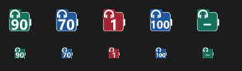
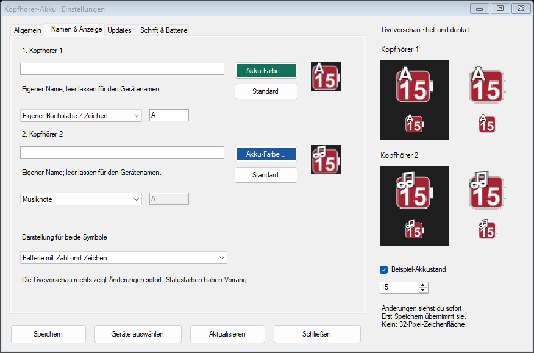
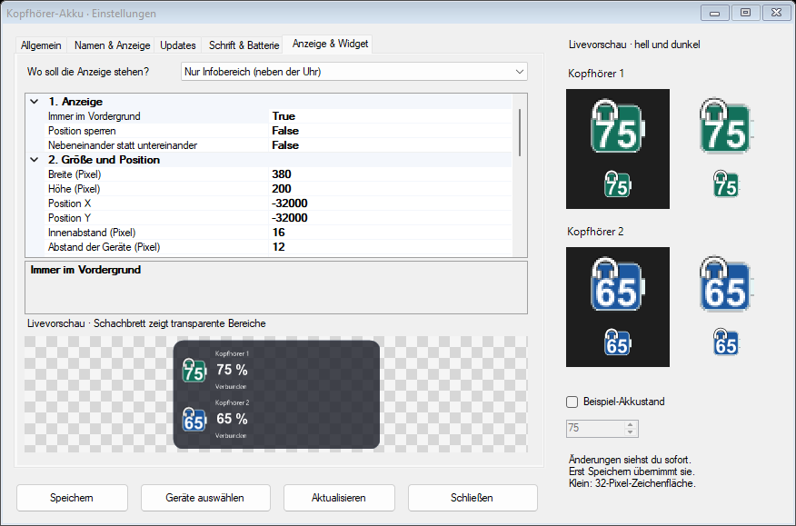
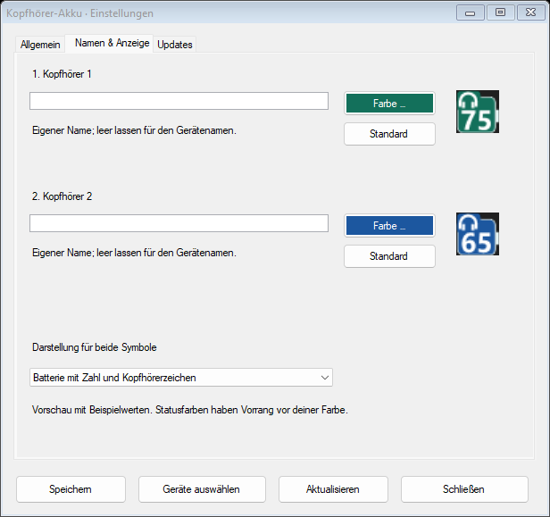

[English](docs/README.en.md) · Deutsch

# Kopfhörer-Akku

Ein kleines Windows-Tool, das den Akkustand von bis zu zwei Bluetooth-Kopfhörern neben der Uhr oder als Desktop-Widget anzeigt. So muss man nicht jedes Mal in den Windows-Einstellungen nachsehen.

Kostenlos und Open Source. Von **Aldikiller**.

## Download

**[Installer herunterladen](https://github.com/Aldikiller/KopfhoererAkku/releases/download/v1.2.0/KopfhoererAkku-1.2.0-Setup.exe)** – mit Installation und Deinstallation.

**[Portable ZIP herunterladen](https://github.com/Aldikiller/KopfhoererAkku/releases/download/v1.2.0/KopfhoererAkku-1.2.0-portable.zip)** – entpacken und ohne Installation starten.

[Alle Downloads](https://github.com/Aldikiller/KopfhoererAkku/releases) · [Quellcode](https://github.com/Aldikiller/KopfhoererAkku/releases/download/v1.2.0/KopfhoererAkku-1.2.0-Quellcode.zip) · [Prüfsummen](https://github.com/Aldikiller/KopfhoererAkku/releases/download/v1.2.0/SHA256SUMS.txt)

Die aktuelle Version ist **1.2.0**. Du brauchst Windows 10 ab Version 2004 oder Windows 11, jeweils in 64 Bit, und .NET Framework 4.8.

## So geht's

1. Installer starten oder die portable ZIP vollständig entpacken.
2. Kopfhörer einschalten und mit Windows verbinden.
3. Im Tool bis zu zwei Geräte auswählen und auf **Übernehmen** klicken. Falls ein Gerät mehrmals auftaucht, den Eintrag mit Akkustand nehmen.
4. Sind die Symbole nicht neben der Uhr zu sehen, unter **^** nachschauen und herausziehen.

Ein Doppelklick auf ein Symbol öffnet die Einstellungen. Unter **Namen & Anzeige** kannst du jeden Kopfhörer umbenennen und seine Farbe auswählen. Das ändert nur die Anzeige im Tool, nicht den Bluetooth-Namen in Windows. Dort kannst du auch zwischen der Batterieanzeige und **nur Zahl mit Kopfhörerzeichen** wechseln.

Unter **Updates** kannst du nach neuen Versionen suchen und die GitHub-Downloadseite öffnen. Auf Wunsch prüft das Tool auch bei jedem Programmstart. Das ist zunächst ausgeschaltet. Es installiert nichts automatisch.

Unter **Allgemein** kannst du die Akkuwarnung und das Abfrageintervall ändern. Mit **Test** lässt sich die Windows-Benachrichtigung ausprobieren.

Per Rechtsklick kannst du andere Geräte auswählen, den Autostart ein- oder ausschalten und das Programm beenden. Im Installer ist der Autostart vorausgewählt.

## Anzeige anpassen

Unter **Namen & Anzeige** kannst du jedem Gerät einen eigenen Namen, eine Farbe und ein Zeichen geben: Kopfhörer, Musiknote, Lautsprecher, ein eigener Buchstabe oder keines. Für die Anzeige stehen eine Batterie mit Zahl oder nur die Zahl mit Zeichen zur Wahl.

Unter **Schrift & Batterie** stellst du Schriftart, Schriftgröße und Schriftfarbe ein. Rundung, Rahmenstärke, Breite und Höhe der Batterie lassen sich getrennt ändern. Windows bestimmt die äußere Größe der Symbole neben der Uhr.

Die Livevorschau zeigt Änderungen sofort auf hellem und dunklem Hintergrund. Du kannst aktuelle Akkuwerte oder einen Beispielwert anzeigen. Erst **Speichern** übernimmt die Änderungen.

## Desktop-Widget

Unter **Einstellungen → Anzeige & Widget** wählst du Infobereich, Desktop-Widget oder beides. Die Optionen darunter lassen sich durch Scrollen erreichen. Die Livevorschau zeigt Änderungen sofort; Speichern übernimmt sie.

Du kannst Größe, Position, Deckkraft, Farben, Schriftart und Schriftgrößen, Rahmen, Rundung, Symbolgröße, Innenabstand und Geräteabstand ändern. Namen, Status und Symbole lassen sich einzeln ausblenden. Die Geräte können neben- oder untereinander stehen. Das Widget übernimmt deine Gerätenamen, Farben und Zeichen.

Mit gedrückter linker Maustaste verschieben; die Position wird gespeichert. Doppelklick öffnet die Einstellungen und Rechtsklick das Menü. Bei Bedarf die Position sperren oder Immer im Vordergrund ausschalten.

Für einen vollständig transparenten Hintergrund **Hintergrund-Deckkraft auf 0** und **Rahmenstärke auf 0** setzen. Die Gesamtdeckkraft wirkt auch auf Schrift und Symbole und kann zwischen 10 und 100 Prozent liegen. Bei Warnungen kann kurzzeitig ein Symbol neben der Uhr erscheinen. Die Größenangaben beziehen sich auf Pixel; Windows-Skalierung kann die Darstellung zusätzlich beeinflussen.

## Was angezeigt wird

Jeder Kopfhörer hat ein eigenes Symbol. Die Zahl im Akku ist der Prozentwert. Wenn du mit der Maus darüberfährst, siehst du den Gerätenamen und den Status.

- **Deine gewählte Farbe:** verbunden (standardmäßig Grün oder Blau).
- **Rot:** verbunden und höchstens 20 % Akku.
- **Grau mit ×:** getrennt.
- **Gelb:** die Verbindung lässt sich gerade nicht feststellen. Eine angezeigte Zahl kann ein gespeicherter Wert sein.
- **? oder –:** es fehlen Daten zum Status oder Akkustand.

## Was man wissen sollte

Das Tool liest die Akkuwerte aus Windows. Es funktioniert deshalb nur, wenn Windows für den Kopfhörer einen Wert bereitstellt. Die Werte können gerundet oder etwas älter sein.

Akkuwerte wurden bisher mit JBL Live 770NC und JLab Rewind 2 ausgelesen. Wie gut andere Modelle funktionieren, hängt davon ab, welche Daten Windows bereitstellt. Akkuwarnungen gibt es nur, wenn die Verbindung bestätigt ist. Windows kann Benachrichtigungen bei „Nicht stören“ unterdrücken.

Die Dateien sind noch nicht digital signiert. Windows kann beim Start einen Warnhinweis anzeigen.

Es gibt keine Werbung und keine Telemetrie. Nur die freiwillige Update-Prüfung fragt GitHub ab. Dabei erhält GitHub deine IP-Adresse und die Programmversion; Gerätenamen und Akkudaten werden nicht gesendet. Deine Einstellungen bleiben auf deinem Rechner. Mehr dazu steht im [Datenschutztext](PRIVACY.md).

## Entfernen

Die installierte Version lässt sich unter **Windows-Einstellungen → Apps** deinstallieren. Die Einstellungen bleiben in `%LOCALAPPDATA%\KopfhoererAkku` erhalten und können bei Bedarf gelöscht werden.

Bei der portablen Version zuerst den Autostart ausschalten, das Tool beenden und dann den Ordner löschen.

Wer noch die frühere Prototyp-Version benutzt, sollte sie vor der Installation beenden und ihren Autostart ausschalten.

## Quellcode und Lizenz

Der Quellcode ist hier im Repository. Mit `build.ps1` lässt sich das Tool selbst bauen. Hinweise dazu stehen unter [Build und Tests](docs/TESTING.md). Fehler kannst du unter [Issues](https://github.com/Aldikiller/KopfhoererAkku/issues) melden. Bitte keine persönlichen Gerätekennungen oder unbereinigten Diagnoseprotokolle hochladen.

Das Projekt wurde mit KI-Unterstützung entwickelt und steht unter der [MIT-Lizenz](LICENSE). Du darfst es unter deren Bedingungen nutzen, verändern und weitergeben. Gewährleistung und Haftung sind soweit gesetzlich zulässig ausgeschlossen. Die [Haftungshinweise](DISCLAIMER.de.md) enthalten die Einzelheiten.

## Code signing policy

SignPath Foundation hat den Antrag vorerst wegen zu geringer öffentlicher Bekanntheit abgelehnt. Eine erneute Bewerbung ist später möglich. Die bisherigen Downloads sind weiterhin unsigniert. Mehr dazu steht in der [Signierrichtlinie](docs/CODE-SIGNING.md).

## Sprache

Unter Einstellungen → Allgemein kannst du Deutsch oder English wählen. Nach Speichern wird die Oberfläche sofort umgestellt. Die Auswahl bleibt beim nächsten Start erhalten. Standard ist Deutsch.
