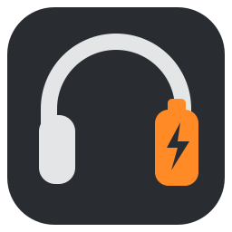
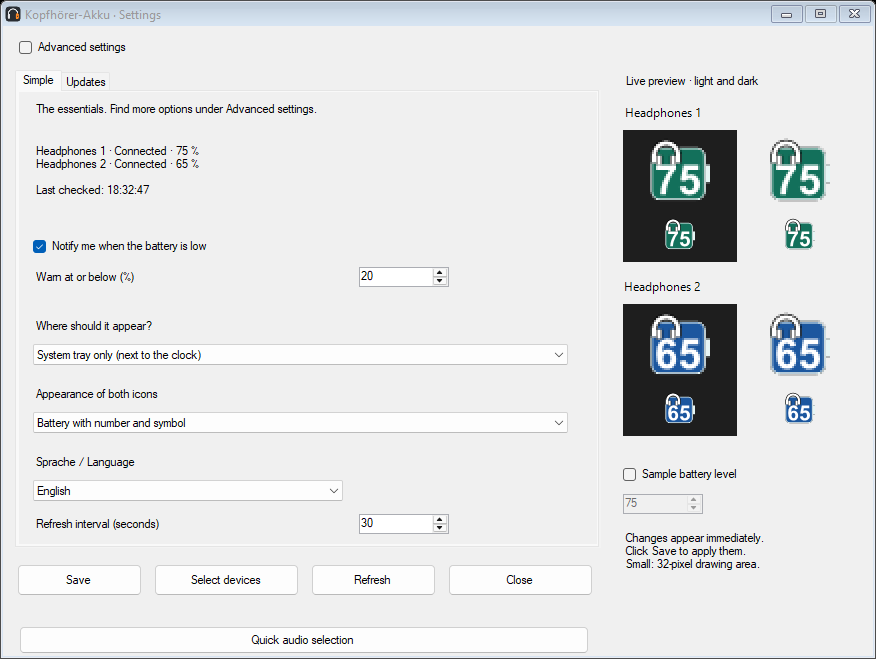
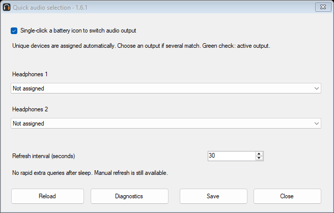
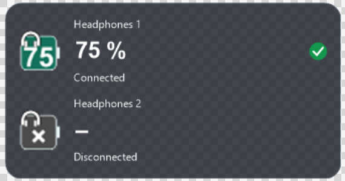
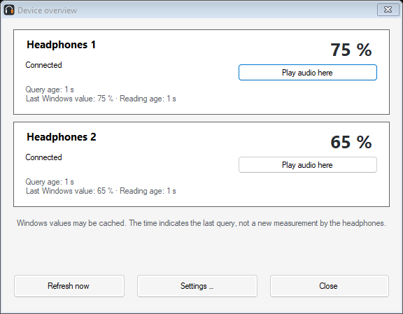

# BleAirDock — Bluetooth battery monitor and audio switcher

BleAirDock was previously called Kopfhörer-Akku. Version 1.7.0 introduces the new name and logo and retains the features of 1.6.5. Installer upgrades preserve settings and device assignments. Existing GitHub and update addresses remain valid.

**Current version: 1.7.0**

## New in 1.7.0

- Standard and Tiny widgets: two clickable icons, adjustable size, layout, fonts, colors and transparency. Tiny shows device names and status on hover; optional screen-edge snapping. Hide / show widget is available in the menu, with tray access retained while hidden.

- Per-headphone warnings with individual thresholds and pulse colors. Pulse warning: 1–90%, period 1–10 seconds, intensity 10–100%, or steady glow. The 30-second test uses the actual tray icon. Pause warnings for 30, 60 or 120 minutes. No extra Bluetooth queries.

- Three customizable shortcuts: toggle, activate headphone 1, activate headphone 2. Combine Ctrl, Alt, Shift and Win with A–Z. Initially disabled; unavailable combinations are reported.

- Per-headphone volume memory is optional: set the initial target, then the app remembers the volume when leaving a device and restores it during one-click audio selection. Mute and microphone settings stay unchanged.

- Import PNG/ICO device images under Names & display → Choose icon. Five SVG and PNG examples are included in docs/symbols. SVG is editable source; PNG/ICO is imported. Tiny can show just the image. Tray images use higher contrast at small sizes; widget images retain their original colors.

- Status messages distinguish not connected, unknown connection, Windows provides no battery level, and query failed. Cached values are never presented as a confirmed current measurement.

## Download

**[Download installer](https://github.com/Aldikiller/KopfhoererAkku/releases/download/v1.7.0/BleAirDock-1.7.0-Setup.exe)** · **[Download portable ZIP](https://github.com/Aldikiller/KopfhoererAkku/releases/download/v1.7.0/BleAirDock-1.7.0-portable.zip)**

[All releases and SHA-256 checksums](https://github.com/Aldikiller/KopfhoererAkku/releases/latest) · [English website](https://aldikiller.github.io/KopfhoererAkku/en.html) · [English wiki](https://github.com/Aldikiller/KopfhoererAkku/wiki/English)

Requires Windows 10 build 19041 or newer, or Windows 11, x64, and .NET Framework 4.8. Downloads are currently unsigned; Windows may show a security warning.

## Switch the app to English

1. Double-click a battery icon to open **Einstellungen** (Settings).
2. In the simple view, find **Sprache / Language**. In advanced settings it is under **Allgemein** (General).
3. Choose **English** and click **Speichern** (Save).

The interface changes immediately and remembers the choice after restarting. These screenshots show the actual English interface of version 1.6.1 with example devices, not live battery measurements.

## Choose audio output with one click

Click a tray battery icon, or the headphone icon, name or battery value in the widget. A green check marks the active Windows output. Unique matching devices are assigned automatically using their shared Windows device identity. If there is no unique match, right-click a tray icon, open **Quick audio selection**, select each output once and save. Existing manual assignments are preserved.

The same mapping and quick-selection setting apply to the tray and widget. Dragging moves the widget without switching audio. Double-click opens settings only. Clicking also works when the widget position is locked. Disabling quick selection restores single-click overview for tray icons.

Switching changes the normal Windows audio output. The microphone and separate communications default are unchanged. Apps with a fixed output may keep their own choice.

## Set up the headphones

1. Install the app, or extract the portable ZIP completely into its own folder and run it.
2. Turn on the headphones and connect them to Windows.
3. Select up to two devices in the app and click **Apply**. If duplicate entries appear, choose the one showing a battery value.
4. If the tray icons are hidden, look under **^** next to the clock and drag them into view.

The installer selects startup with Windows by default. You can change this in the right-click menu. The portable edition stores settings beside the app.

## Overview and battery checks

Right-click a tray icon and choose the device overview to see both headphones and their last Windows query times. Hover over an icon for the device name, battery level and query age.

Battery checks default to 30 seconds and can be set from 30 to 300 seconds. No rapid extra polling after sleep, and no routine progress banners. Real errors and uncertain connection states remain visible. Windows may cache values; a query timestamp does not confirm a fresh battery measurement by the headphones.

## Customize the display

Settings open in a simple view. Select **Advanced settings** for all controls. Change device labels, colors and symbols, fonts, battery size, corner radius and outline thickness. Choose a battery with a number, or a number with a symbol. The live preview shows changes before saving. Windows controls the outer size of tray icons.

The widget has independent size, position, opacity, fonts, spacing and layout settings. Choose tray, widget or both in display settings. For a clear background, set background opacity and frame thickness to zero. Overall opacity also affects text and symbols.

## Warnings and limits

Low-battery warnings require a confirmed connection and a battery value. Use the notification test in general settings. Windows Do Not Disturb may suppress notifications.

The app displays only battery values supplied by Windows and the device driver. Values may be rounded or delayed; some models do not provide compatible data. Battery readings have been reported with **JBL Live 770NC** and **JLab Rewind 2**. This does not establish compatibility with every device or Windows configuration. [Compatibility notes](COMPATIBILITY.md).

## Updates and privacy

App update checks are manual or optionally run at startup; the automatic option is off by default. They open the GitHub download page and never install an update automatically. This is separate from battery polling.

No ads or telemetry. Settings and audio mappings stay on your computer. The optional update check sends your IP address and app version to GitHub, but not device names, device identifiers or battery levels. [Privacy details](../PRIVACY.md).

## Remove the app or report a problem

Uninstall the installed edition through Windows Settings → Apps. Settings remain in `%LOCALAPPDATA%\KopfhoererAkku`. For portable mode, disable startup, quit the app and remove its extracted folder.

[Report a problem](https://github.com/Aldikiller/KopfhoererAkku/issues) with the headphone model, Windows and app versions, expected behavior and steps to reproduce. Remove private device identifiers and Bluetooth addresses from screenshots and logs.

Free and open source under the [MIT license](../LICENSE), provided without warranty to the extent permitted by law. German documentation and the German default interface remain available.

## Find us on AlternativeTo

[View BleAirDock on AlternativeTo](https://alternativeto.net/software/kopfhorer-akku/) — compare similar tools or share your experience.
